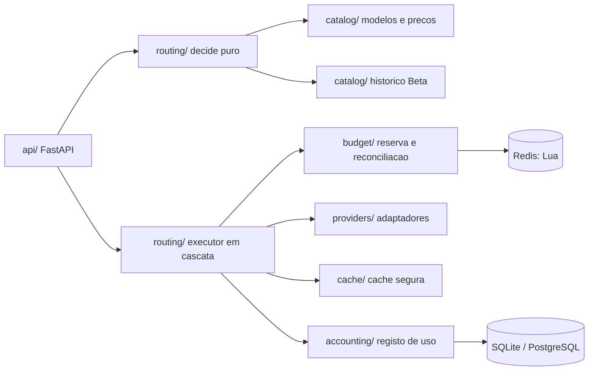

# 00 — Visão geral do CostPilot

## O problema

Usar sempre o modelo caro desperdiça dinheiro. Usar sempre o barato degrada a qualidade e, por causa
dos retries e das falhas, pode sair mais caro no fim. O CostPilot escolhe, para cada pedido, o
**modelo mais barato que ainda resolve bem a tarefa**, e mede o custo por **tarefa resolvida**
(`custo_total / tarefas_correctas`), não o preço por token.

## O que entra e o que sai

Entra um pedido com o tipo de tarefa, o tamanho estimado do input, requisitos (JSON, ferramentas),
SLA de latência, sensibilidade e tecto de custo. Sai uma decisão explicável:

```text
POST /route  ->  modelo escolhido, candidatos com custo esperado, excluídos com motivo
POST /execute -> resposta validada, tentativas (com custo de cada uma), orçamento reconciliado
```

Saída real dos testes desta fase (execução de `pytest` na raiz do projecto):

```text
46 passed, 1 skipped in 30.25s
SKIPPED backend\tests\test_budget_redis_real.py:31: COSTPILOT_TEST_REDIS_URL não definido
```

O `skipped` é o teste contra Redis real: sem servidor acessível, não é fingido.
Atualização de 2026-11-24: o teste isolado passou contra Redis 7.4.11
(`1 passed, 174 deselected`); ver `01-gateway-minimo-e-orcamento-atomico.md`.

## Mapa do código



Cada pasta de `backend/app/` corresponde a uma responsabilidade do `design.md`. As camadas de
decisão (`routing`) não fazem I/O: recebem factos e devolvem uma decisão, por isso são testáveis
sem rede nem base de dados.

## Porquê um gateway próprio

O OpenRouter e o LiteLLM já fazem routing. A contribuição deste projecto é a **política**
(custo esperado por tarefa resolvida, com restrições de qualidade medidas) e a **prova experimental**
contra baselines simples. O gateway mínimo existe para que o projecto corra e seja avaliado sozinho.
O ModelMesh entra como provider opcional, não como dependência.

## Como falha

- Os perfis de qualidade dos mocks determinam os resultados em mock. Por isso os números de mock são
  marcados como `simulated` e não servem de prova de poupança real (ver `06-contrafactual-e-ablacao.md`).
- A prova com Redis real cobre a concorrência do orçamento, mas não o caminho HTTP completo
  nem a cache (ver `01-gateway-minimo-e-orcamento-atomico.md`).

## Perguntas de entrevista

**Porque medir custo por tarefa resolvida e não custo por token?**
Um modelo barato com 40% de falhas e retries pode custar mais por resposta correcta do que um modelo
caro com 95% de sucesso. O custo por token não vê o retry nem a correcção; o custo por tarefa resolvida vê.

**Porque é que a política é uma função pura?**
Porque a mesma função serve o `/route`, a simulação contrafactual e os testes. Sem efeitos colaterais,
o resultado depende só dos argumentos, e a decisão pode ser reproduzida a partir do registo.

**O que é que o CostPilot não faz?**
Não faz routing semântico por embeddings, não faz cache semântica e não faz failover multi-provider
avançado (esse é o papel do ModelMesh). Estão fora de âmbito no `proposal.md`.
